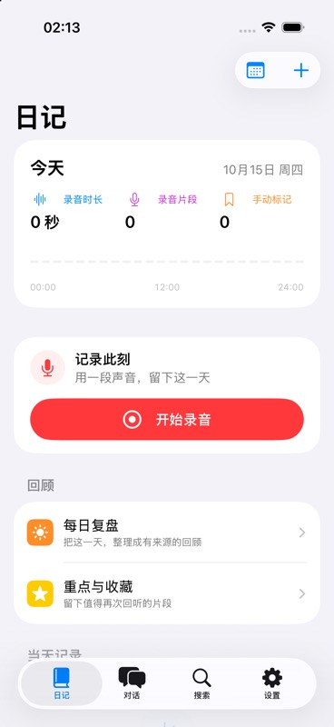
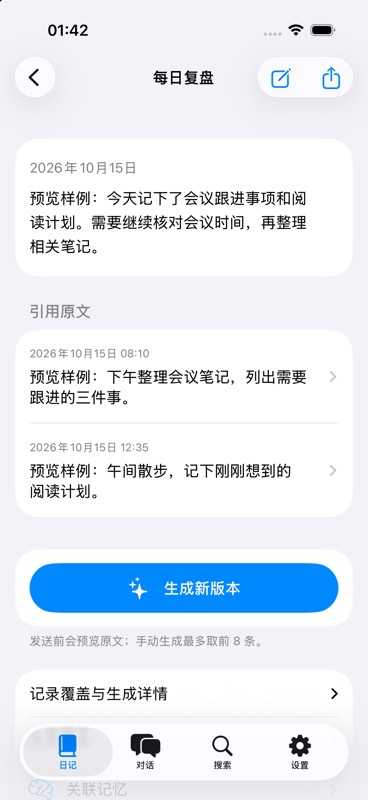
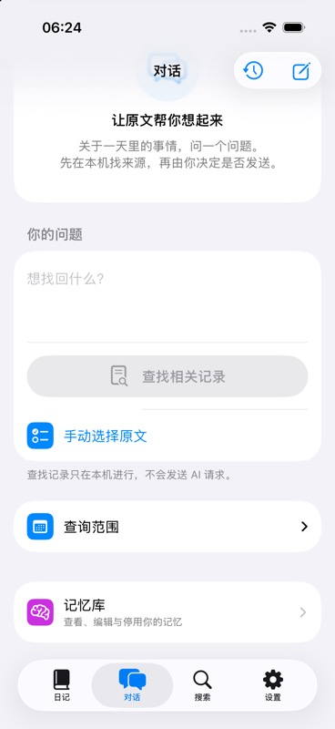
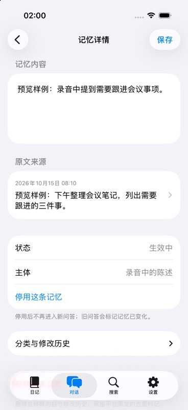

<div align="center">

# DayTrace

### 留住一天，找回原话。

iPhone 与 Apple Watch 上的本地优先声音日记与个人记忆助手。


[功能](#功能) · [隐私](#隐私与数据) · [运行](#从源码运行) · [验证](#验证与路线图) · [参与](#参与项目)

</div>

随手录下想法、会议和生活片段，在需要时按日期、关键词或一个问题找回来。DayTrace 将录音、转写、每日回顾和可追溯的记忆放在同一个原生应用里，每一条引用都能回到原文与录音核对。

原始音频保存在设备上。AI 是需要配置和授权的可选能力；本地录音、转写与关键词搜索不需要 AI 服务。

## 应用预览

<table>
<tr><th>日记</th><th>每日复盘</th><th>对话</th><th>记忆</th></tr>
<tr>
<td></td>
<td></td>
<td></td>
<td></td>
</tr>
</table>

真实 iOS 模拟器截图。复盘与记忆中的“预览样例”是合成演示内容，用于展示界面，不代表实际 AI 质量。

## 适合怎样的记录

- 想快速留下一段声音，稍后再整理。
- 想从一天的记录中找回某句话、一个约定或值得回听的片段。
- 希望在使用 AI 整理前，自己决定使用哪家服务、发送哪些文字。
- 希望记忆可以核对、编辑和删除，而不是只能接受一段总结。

## 功能

| 能力 | 体验 |
| --- | --- |
| 声音记录 | iPhone 录音与音频导入；Watch 端支持开始、标记、暂停和结束，传输后由手机确认持久化。 |
| 本地转写 | 使用设备上的 Speech 能力生成原文；支持纠错、倍速回听和时间跳转。 |
| 每日回顾 | 按日期和小时浏览；复盘保留引用，编辑形成版本，分享前可以检查和排除内容。 |
| 搜索与对话 | 本地关键词与日期筛选；系统模型可用时支持语义检索，对话可手动选择来源并保存历史。 |
| 重点与记忆 | 标记、收藏和来源核对；记忆可以编辑、停用或删除，未确认的内容不直接成为用户事实。 |
| 可选 AI | 自行配置服务与模型，分别授权自动复盘、记忆和重点，设置调用预算并查看外发记录。 |
| 数据管理 | 音频留存、受保护片段提取，以及密码加密的备份和恢复。 |

健康与位置是额外的可选上下文：主动读取，本机展示与向 AI 发送分别控制，没有后台位置跟踪。

## 隐私与数据

**本地优先，不等于默认外发。**

- 音频留在本机，转写要求端侧支持；不会静默切换到云端 ASR，AI 请求不发送原始音频。
- 手动 AI 请求由用户触发；自动用途需明确授权，绑定具体服务、模型和预算。健康、位置另行选择。
- 外发记录保留实际使用的文字来源与结果；密钥保存在设备 Keychain，不包含在备份中。
- 删除标记先持久化，阻止晚到的同步、转写或 AI 结果重新建立已删除内容。
- 普通原音默认在结束后 30 天到期；转写、会话与保护片段满足清理条件后才能删除。Mark 和收藏保护相应范围，文本保留。
- 加密备份由自己保管；恢复先验证，再替换本地库，并暂停自动外发和上下文授权。

## 从源码运行

### 环境

macOS、支持目标设备的 Xcode 和 SDK；iOS 18+、watchOS 11+。重新生成项目需要 XcodeGen。仓库同时提供可直接打开的 Xcode 项目，无第三方运行时依赖。

```sh
git clone https://github.com/liwenjinchn/DayTrace.git
cd DayTrace
open DayTrace.xcodeproj
```

在 Xcode 中选择 `DayTrace` scheme 和目标模拟器。真机需使用自己的开发签名、开发者模式及所需 entitlement；Watch 联调还需要配对设备。

修改 `project.yml` 中的 `DEVELOPMENT_TEAM`、项目配置或新增文件后，重新生成：

```sh
xcodegen generate
```

Watch 单独构建选择 `DayTraceWatch` scheme。包含 Watch 的构建通过 destination 选择平台，避免全局指定 iPhone SDK。

### 第一次使用

1. 录一段声音或导入音频，先验证本地转写与原文回听。
2. 需要 AI 时，在设置中填写自己的 HTTPS 服务、模型和密钥。
3. 检查发送来源；需要自动处理时，再选择用途与预算。
4. 按需开启健康、位置或音频自动清理，并定期导出加密备份。

连接测试发送合成文字，可能产生服务费用；客户端额度预约不等于服务商的计费金额。

## 技术结构

```text
iPhone/       SwiftUI 界面、录音、转写、检索与设备持久化
Watch/        手表录音、标记、会话与传输队列
Shared/       数据模型、来源验证、留存、AI 协议与加密备份
Tests/        Swift Package 核心测试
NativeTests/  iOS 数据流程与条件启用的设备验收
docs/         项目展示截图
project.yml   XcodeGen 项目配置
```

核心框架：SwiftUI、AVFoundation、WatchConnectivity、Speech、NaturalLanguage、HealthKit、CoreLocation、CryptoKit 与 Security。界面参考 [Apple 人机界面指南](https://developer.apple.com/design/human-interface-guidelines/) 与 [官方设计资源](https://developer.apple.com/design/resources/)。

## 验证与路线图

开发中的项目，尚未发布 App Store / TestFlight 版本。以下是截至 **2026-10-15** 的验证状态：

| 检查 | 结果 |
| --- | --- |
| Swift 核心测试 | 94 通过，0 失败 |
| iOS 模拟器数据流程测试 | 9 通过，0 失败，9 条件跳过 |
| iOS / Watch 模拟器构建 | 通过 |
| iPhone 安装与启动 | 已验证；不代表全部功能已验收 |
| UI 检查 | 50 张页面与状态截图；深色与大字号抽样 |

9 项跳过包含 6 项需显式开启的在线 / 公开语料验收、2 项麦克风权限检查、1 项模拟器中文语义模型不可用的检查。构建与截图不替代实际录音质量或长时稳定性验证。

```sh
swift test --build-system native

xcodebuild -project DayTrace.xcodeproj -scheme DayTrace \
  -destination 'generic/platform=iOS Simulator' CODE_SIGNING_ALLOWED=NO build

xcodebuild -project DayTrace.xcodeproj -scheme DayTraceWatch \
  -destination 'generic/platform=watchOS Simulator' CODE_SIGNING_ALLOWED=NO build
```

接下来优先完善：

- [ ] Watch 真机录音、同步与会话完整性验收。
- [ ] 长时录音、锁屏调度、中断恢复与电池消耗验证。
- [ ] 中文和混合语言转写、语义检索及引用质量。
- [ ] 大规模记录库、备份与首次索引性能。
- [ ] 完整 VoiceOver 与动态字号检查。

Watch 切段录音可能有间隙；自动任务仅在 App 能运行时推进，不保证后台准点执行。语义模型不可用时保留本地关键词检索。

## 参与项目

欢迎通过 [Issues](https://github.com/liwenjinchn/DayTrace/issues) 报告问题或讨论改进。请附设备 / 系统版本、复现步骤和预期结果，演示材料使用合成数据，并移除密钥、个人录音和健康位置信息。

涉及数据生命周期、来源有效性或外发授权的改动，请先说明行为和验证方式。UI 改动可以附同一状态的前后截图。

仓库不包含本地录音、个人验收日志、密钥和构建产物。应用图标正在重新设计，暂不作为最终品牌资产展示。
